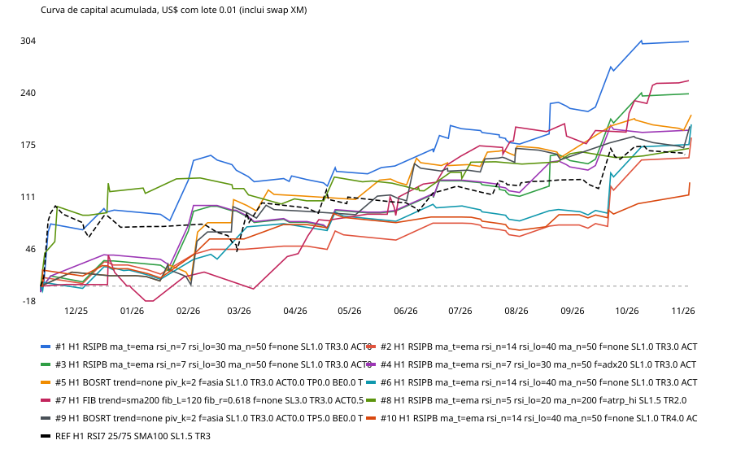

# Fase 1 — backtest em massa BTCUSD (H1/H2/H4)

Gerado em 2026-11-10T21:55 UTC. Dados: ticks reais BTCUSD do MT5 (XM) 01/11/2025 → 10/11/2026, barras BID com spread médio real da barra; entrada no open da barra seguinte; 1 posição; motor `engine2.py` (= `bt` do `engine.py` + breakeven, slippage, swap e time-stop; idêntico ao original quando desligados).

Custos: contract size 1 (US$ = pontos × 1 × 0.01); swap XM lido de `mt5.symbol_info` (modo 1: long -3220.34 / short -2146.89 pontos por noite = US$ -0.32 / -0.21 por noite com 0.01 lote), cobrado a cada virada de dia do servidor (NY+7h).

## Volume testado

- **6,290,176 combinações novas** ({'H1': 2097152, 'H2': 2097152, 'H4': 2097152}); 1280 combinações idênticas às de `resultados_10944.csv` foram excluídas do ranking.
- Com ≥40 trades: 1,925,337. Passaram trades + PF IS>1.3 + PF OOS>1.2: 49,047 (22,905 com comportamento distinto).
- **Aprovadas em todos os critérios: 12,692 (5,109 distintas).** Muitas variantes são idênticas na prática (ex.: com SL 1 ATR e trailing 3 ATR a ativação 0–1.5R nunca muda o stop); o ranking guarda só a mais simples e conta as demais em `equivalentes`.

Critérios: ≥40 trades; PF IS (11/2025–06/2026) > 1.3; PF OOS (07/2026–11/2026) > 1.2; ≥60% dos vizinhos (±1 passo em cada parâmetro ordenado) lucrativos; maior trade ≤30% do lucro; spread ×1.5 + slippage 10 pts com PF > 1.10; walk-forward (3 janelas: mar–mai, jun–ago, set–nov/2026) com PF>1 em ≥2 janelas e soma positiva.

## Top 10 (distintas, aprovadas)

| # | TF | Família | Parâmetros | Filtro | SL/Trail/Ativ/TP/BE/TS | Trades | US$ | PF | PF IS | PF OOS | PF estresse | WF PF | Vizinhos | Maior trade | DD US$ | Meses + | Acerto |
|---|---|---|---|---|---|---|---|---|---|---|---|---|---|---|---|---|---|
| 1 | H1 | RSIPB | `ma_t=ema rsi_n=7 rsi_lo=30 ma_n=50` | none | 1.0/3.0/0.0/0.0/0.0/0 | 56 | 303 | 3.19 | 3.09 | 3.42 | 3.10 | 1.14/2.90/7.56 | 100% | 21% | 38 | 11/13 | 41% |
| 2 | H1 | RSIPB | `ma_t=ema rsi_n=14 rsi_lo=40 ma_n=50` | none | 1.0/3.0/0.0/0.0/1.0/0 | 44 | 184 | 3.78 | 3.08 | 4.72 | 3.72 | 1.75/2.14/9.91 | 90% | 27% | 16 | 10/13 | 32% |
| 3 | H1 | RSIPB | `ma_t=ema rsi_n=7 rsi_lo=30 ma_n=50` | none | 1.0/3.0/0.0/0.0/1.0/0 | 56 | 238 | 3.23 | 2.93 | 3.75 | 3.14 | 0.99/3.07/7.56 | 100% | 21% | 28 | 10/13 | 32% |
| 4 | H1 | RSIPB | `ma_t=ema rsi_n=7 rsi_lo=30 ma_n=50` | adx20 | 1.0/3.0/0.0/0.0/1.0/0 | 50 | 193 | 3.02 | 3.18 | 2.75 | 2.97 | 0.99/3.04/4.60 | 100% | 26% | 28 | 9/13 | 30% |
| 5 | H1 | BOSRT | `trend=none piv_k=2` | asia | 1.0/3.0/0.0/0.0/0.0/0 | 47 | 212 | 2.89 | 2.98 | 2.71 | 2.81 | 1.73/1.79/4.72 | 100% | 28% | 19 | 9/13 | 43% |
| 6 | H1 | RSIPB | `ma_t=ema rsi_n=14 rsi_lo=40 ma_n=50` | none | 1.0/3.0/0.0/0.0/0.0/0 | 44 | 201 | 3.12 | 2.58 | 4.09 | 3.04 | 3.38/1.64/8.08 | 100% | 25% | 21 | 10/13 | 41% |
| 7 | H1 | FIB | `trend=sma200 fib_L=120 fib_r=0.618` | none | 3.0/3.0/0.5/5.0/1.0/0 | 47 | 255 | 2.72 | 2.57 | 3.04 | 2.56 | 3.06/3.42/5.63 | 100% | 16% | 57 | 11/13 | 60% |
| 8 | H1 | RSIPB | `ma_t=ema rsi_n=5 rsi_lo=20 ma_n=200` | atrp_hi | 1.5/2.0/0.0/5.0/1.0/0 | 41 | 171 | 2.70 | 2.70 | 2.71 | 2.52 | 1.22/2.63/1.95 | 100% | 26% | 32 | 9/13 | 54% |
| 9 | H1 | BOSRT | `trend=none piv_k=2` | asia | 1.0/3.0/0.0/5.0/0.0/0 | 48 | 198 | 2.67 | 2.74 | 2.51 | 2.62 | 1.36/2.23/3.91 | 100% | 27% | 25 | 7/13 | 42% |
| 10 | H1 | RSIPB | `ma_t=ema rsi_n=14 rsi_lo=40 ma_n=50` | none | 1.0/4.0/0.0/3.0/1.0/0 | 44 | 129 | 2.94 | 3.28 | 2.51 | 2.93 | 2.33/1.60/4.30 | 82% | 22% | 21 | 10/13 | 32% |
| ref | H1 | RSIPB | `RSI7 25/75, SMA100` | none | 1.5/3/0/0/0/0 | 61 | 163 | 1.82 | 1.85 | 1.75 | 1.75 | – | – | – | 57 | 9/13 | 39% |

## Resultado mensal (US$, lote 0.01, com swap)

| Mês | #1 | #2 | #3 | #4 | #5 | #6 | #7 | #8 | #9 | #10 | REF |
|---|---|---|---|---|---|---|---|---|---|---|---|
| 2025-11 | 77 | 10 | 12 | 12 | 17 | 4 | 2 | 99 | 17 | 20 | 89 |
| 2025-12 | 17 | 16 | 19 | 26 | -4 | 15 | -4 | 18 | -4 | 2 | -16 |
| 2026-01 | 37 | -11 | 37 | 37 | 5 | -11 | 14 | 16 | -1 | -11 | 1 |
| 2026-02 | 12 | 31 | 25 | 19 | 90 | 25 | 6 | -12 | 86 | 48 | -31 |
| 2026-03 | -7 | 4 | -14 | -14 | 6 | 44 | 19 | -13 | -4 | 18 | 61 |
| 2026-04 | 6 | 14 | 15 | 15 | -2 | 10 | 46 | 27 | -2 | 9 | 7 |
| 2026-05 | 7 | -6 | -1 | -1 | 17 | -6 | 28 | -8 | 16 | -6 | -7 |
| 2026-06 | 50 | 21 | 38 | 38 | 20 | 17 | 39 | 13 | 33 | 7 | 20 |
| 2026-07 | -21 | -14 | -17 | -13 | 13 | -14 | 47 | 13 | 28 | -14 | 2 |
| 2026-08 | 42 | 12 | 42 | 30 | -3 | 12 | -11 | 10 | -14 | 17 | 6 |
| 2026-09 | 47 | 43 | 47 | 47 | 39 | 40 | 5 | -5 | 21 | 1 | 26 |
| 2026-10 | 34 | 37 | 34 | -4 | -3 | 37 | 61 | 2 | -4 | 13 | 11 |
| 2026-11 | 3 | 28 | 3 | 3 | 17 | 28 | 3 | 9 | 24 | 26 | -5 |

## Walk-forward do processo de seleção (leitura obrigatória)

Em cada janela, escolhe-se o top 10 por PF **só com dados anteriores** (treino ancorado desde 11/2025, mesmos critérios de trades/PF/vizinhança) e mede-se o resultado na janela seguinte:

| Janela de teste | Candidatas no treino | PF agregado do top 10 no teste | US$ no teste | Positivas |
|---|---|---|---|---|
| 2026-03..2026-06 | 2102 | 0.88 | -47 | 0/10 |
| 2026-06..2026-09 | 2035 | 0.40 | -239 | 0/10 |
| 2026-09..2026-12 | 1943 | 8.52 | 816 | 10/10 |

Escolher a "melhor" pelo passado falhou em 2 das 3 janelas. Com 6,3 milhões de combinações, PF alto em IS e OOS ao mesmo tempo aparece também por acaso, e o próprio OOS deixa de ser fora da amostra quando entra no filtro. Os números do top 10 acima são, portanto, **otimistas**; espere resultado ao vivo bem menor. O período inteiro tem um único regime dominante (BTC de ~110k para ~60k), o que favorece vendas a favor da tendência.

## Escolha para o agente (Fase 2)

A nº 1 aprovada é da mesma família da referência (RSI7 H1, trailing 3×ATR, sem TP), muda só a média (EMA50 em vez de SMA100), o nível (30/70 em vez de 25/75) e o SL (1.0 em vez de 1.5 ATR). Variando um parâmetro por vez, todas as vizinhas com trades suficientes continuam lucrativas. Ela vai como padrão do agente; a referência fica pronta no mesmo config (bloco comentado).
